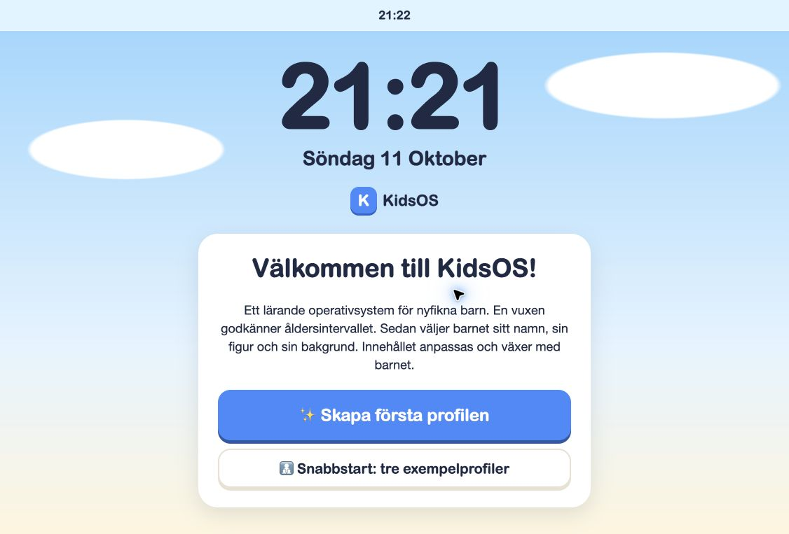
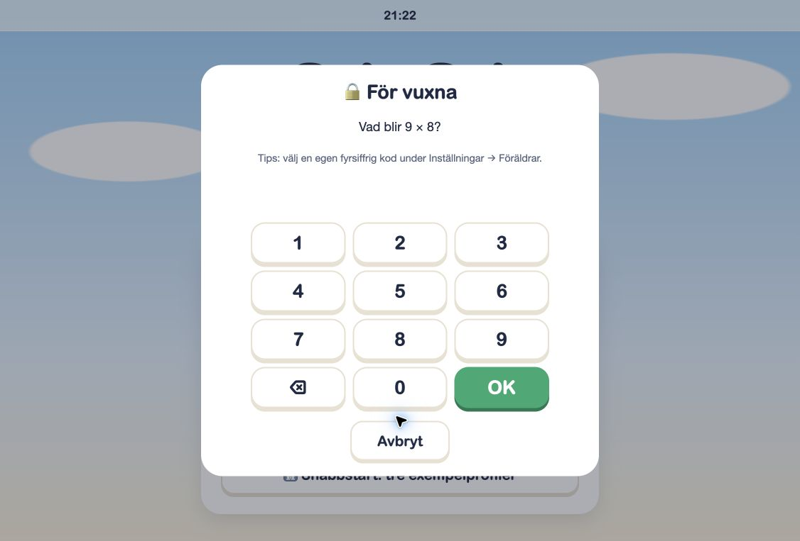
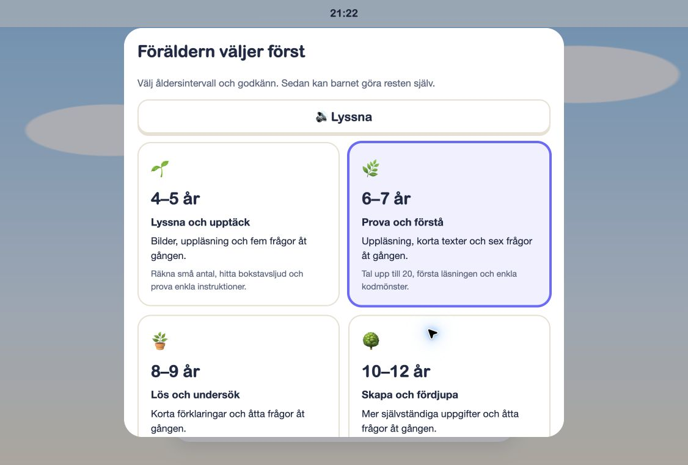
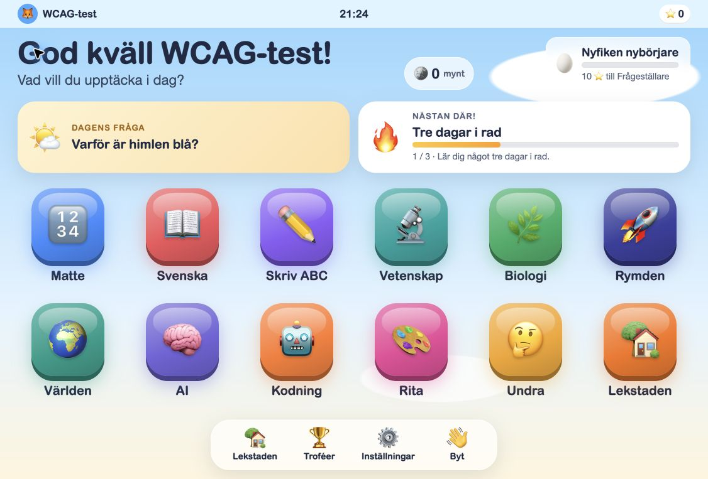
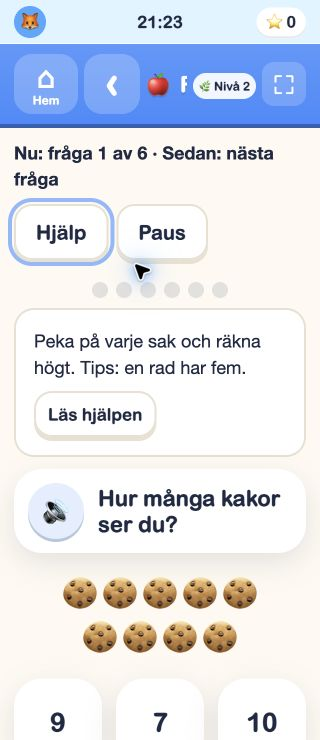
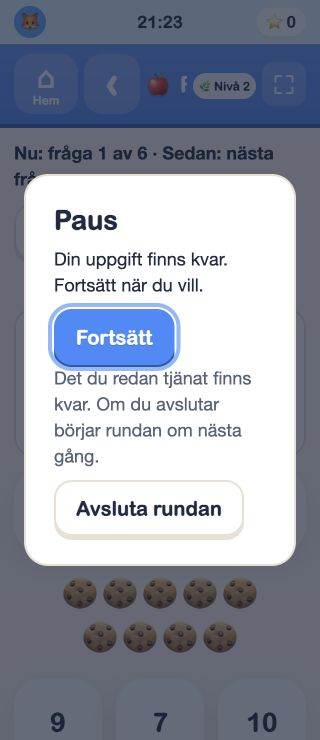

# KidsOS – verifierad Chrome-genomgång

Datum: 2026-10-11. Källa: https://kids.kevinmarquez.se/ i användarens anslutna Chrome. Publicerad app granskad; lokala ändringar har inte publicerats i detta varv. Testprofilen `WCAG-test`, 6–7 år, skapades i den här webbläsarens lokala lagring. Ordinarie profiler ändrades inte.

Den publicerade webbadressen är nu åtkomlig. Den tidigare spärren gällde lokal filvisning; den har inte kringgåtts. Chrome-kontrollen gäller en separat, uttryckligen angiven publicerad webbadress.

## Steg och skärmbilder

1. **Start – fungerar.** Svenskt dokument, tydlig huvudrubrik, två namngivna startknappar. Viewport tillåter zoom och inga externa CSS-länkar observerades. Full kontrastinventering återstår.

2. **Föräldraspärr – fokusfel verifierat.** Efter öppning pekade `document.activeElement` fortfarande på Skapa första profilen bakom dialogen. Svar via sifferknappar gick att mata in. Den publicerade dialogen saknar det vanliga inmatningsfält som finns i senare lokal kod. Fokus, bakgrundsisolering och kodfält är lokalt åtgärdade sedan tidigare; rättningarna är ännu inte verifierade på publicerad app.

3. **Profilguide – kan slutföras.** Åldersval, namn, figur och bakgrund ledde till en separat testprofil. Namnfältet har tillgängligt namn. Figurernas namn och färgvalens generiska namn behöver förbättras. Ålderspanelen scrollar; samtliga val syns inte samtidigt i bilden. Det är inget bevis på klippning eftersom panelen går att scrolla.

4. **Hem och öppet appfönster – bakgrundsfokusfel verifierat.** Hemskärmen visade alla tolv appar när öppningsanimationen var klar. Efter att Matte öppnats och Shift+Tab tryckts från Hem-knappen hamnade fokus på Byt i `.screen`, trots att `.window.open` låg framför. Hemskärmen isoleras nu i lokal kod med inert/aria-hidden när ett surfplattefönster öppnas och återställs vid Hem. Appens rubrik får fokus vid öppning och navigation.

5. **Quiz vid 320 × 740 CSS-px – delvis godkänt i detta flöde.** `innerWidth=320`, dokumentets scrollWidth=320; de tre svarsknapparna var 88 × 88 px och låg inom bredden. Hjälp gick att aktivera med Enter. Hjälppanelen ökade höjden och svaren krävde scroll. Rubriken Räkna blev klippt av nivåchipet och andra kontroller. Lokal CSS lämnar mer utrymme åt titeln vid smal bredd och behåller nivåinformationen för hjälpmedel. Det är inte en generell reflow-verifiering för alla aktiviteter.

6. **Paus – fungerar i det testade flödet.** Enter på Paus öppnade dialogen; faktisk aktiv kontroll blev Fortsätt. Escape stängde dialogen och återställde fokus till Paus. Samma fråga bevarades. Ingen fel-/varningslogg rapporterades i den insamlade konsolloggen. VoiceOver och Switch Control har inte testats.

## Lokal ändring och verifiering

Nytt regressionstest kontrollerar att öppet surfplattefönster gör hemskärmen inert och dold för hjälpmedel och att Hem återställer detta. Publicerade appen bevisar det tidigare felet; DOM-testet verifierar rättningens attribut/livscykel. Lokal byggkontroll är inte bevis för faktisk fokusordning i publicerad Chrome.

Alla sparade skärmbilder har öppnats och inspekterats. En tidig hemskärmsbild före avslutad ikonanimation och en tidig mobilbild före avslutad fönsteranimation ersattes med stabila bilder. Tillfällig viewportstorlek återställdes efter testet. Chrome-fliken behålls för fortsatt arbete.

Nästa verifiering: publicera de granskade ändringarna efter användarens instruktion och kör om fokus- och mobilflödena. Testa därefter övriga aktivitetsfamiljer, förstoring/textavstånd, kontrasttillstånd, tangentbordsslutförande och VoiceOver. Full WCAG 2.2 AA-överensstämmelse är inte fastställd.
