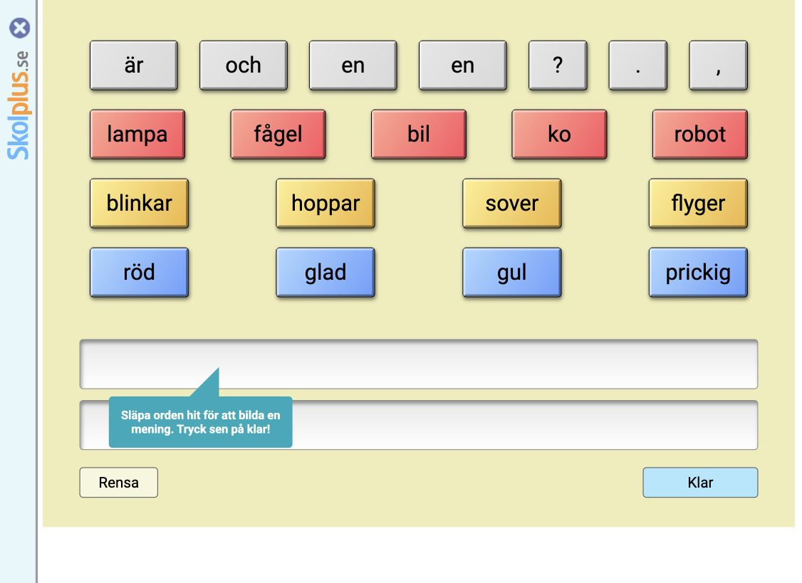

# Skolplus → egna aktiviteter i KidsOS

Genomgång: 2026-10-12. Syfte: hitta pedagogiska upplägg som tillför något i KidsOS och kan få en egen, modern och tillgänglig utformning. Detta dokument är en aktivitetsplan, inte nya implementerade moduler.

## Underlag och begränsningar

Skolplus offentliga kataloger för matematik, svenska, stegvis färdighetsträning, blandade ämnen, NO, SO, bild och rörelse granskades. Matematik- och svenskakatalogerna öppnades också i Chrome. Två offentligt länkade aktiviteter öppnades: en räkneaktivitet och en meningsbyggare. Meningsbyggaren startades och dess ordval/meningsyta inspekterades; inget fullständigt speltest genomfördes. Betalmaterialets beskrivningar granskades, men låsta aktiviteter, elevhäften och filmer har inte testats eller laddats ner.

KidsOS aktuella appregister och aktivitetsbanker användes för jämförelsen. Bedömningarna nedan är våra produktförslag; katalogbeskrivningar visar vad Skolplus erbjuder men bevisar inte lärandeeffekt eller lämplighet för ett visst barn.

## Verifierade inspirationsområden

- Matematik: matchningsspel, bingo, talverktyg, pengar, bråk, koordinater, geometribyggande och mönster. [Matematikkatalog](https://skolplus.se/matematik).
- Svenska: bokstavspar, ord/bild, berättelsestöd och meningsbygge. [Svenskakatalog](https://skolplus.se/svenska).
- Progression: avgränsade färdigheter och undervisningsdelar inom tal/stavning/grammatik. [Matteraketen](https://skolplus.se/matteraketen), [Svenskaraketen](https://skolplus.se/svenskaraketen).
- Andra ämnen: kartor, symboler, logik, musikskapande och minnesuppgifter. [Blandade ämnen](https://skolplus.se/ovriga_amnen).
- Praktiskt lärande: laborationer, växtkort, kartkunskap och skapande på papper. [NO](https://skolplus.se/teacher/no), [SO](https://skolplus.se/teacher/so), [Bild](https://skolplus.se/teacher/bild).
- Rörelsepauser med film finns som separat erbjudande. [Rörelseäventyret](https://skolplus.se/rorelse).

## Prioriterad aktivitetsplan

Namnen i tabellen är förslag till KidsOS, inte kopior av Skolplus produktnamn. Åldrar är föreslagna startintervall och måste gå att anpassa efter erfarenhet, språk och stödbehov.

| Prioritet | Egen aktivitet | Barnets handling och modern utformning | Startålder | Befintlig grund i KidsOS | Nytta/arbetsinsats |
|---|---|---|---|---|---|
| P1 | Parverkstaden | Para tal med antal, ord med bild eller stora med små bokstäver. Stora rena kort, 2–6 par, öppna kort som stödval. | 4–7 | `case`, `letterpic`, `count`; ny gemensam parvy | Hög / medel |
| P1 | Berättelseateljén | Välj person, plats och händelse och skapa tre scener. Berätta muntligt, skriv eller lägg till en egen teckning. | 4–12 | `stories`, Anteckningar, galleri, studiofigurer | Hög / medel |
| P1 | Talverkstaden | Bygg tal med ental och tiotal. Växla tio ental till ett tiotal och visa bild, tal och förklaring tillsammans. | 5–9 | `placevalue`, `column`, befintliga talbilder | Hög / medel |
| P1 | Bråkköket | Dela lika stora portioner, jämför delar och förklara varför två halvor bildar en hel. Ren arbetsyta med bild och text. | 6–10 | `sharing`; behöver praktisk bråkvy | Hög / medel–stor |
| P1 | Min kartresa | Följ egna uppdrag på en enkel karta: symboler, väderstreck och senare rutsystem/skala. Karta och valbara platskort. | 6–12 | `sweden`, `compass`, `activity-practice` | Hög / medel |
| P1 | Naturens par | Matcha egna foton av djur, löv och livsstadier med namn eller ledtråd. Utforska före matchning; använd samma parvy. | 5–10 | Artkort, `lifecycle`, befintliga foton | Hög / låg efter parvyn |
| P2 | Ordscenen | Bygg flera rimliga meningar med ordkort och se en enkel scen ändras. Läs hela meningen; acceptera alternativa korrekta ordföljder. | 6–10 | `sentence`, `build`, `contextwords` | Hög / medel–stor |
| P2 | Min formverkstad | Bygg figurer i ett punktnät, räkna hörn och jämför omkrets. Sätt punkter med tryck eller tangentbord. | 5–12 | `shapes`, kodritning, bildverkstad | Medel–hög / medel |
| P2 | Mönsterstudion | Lägg egna plattor, skapa upprepningar och undersök symmetri. Spara en egen mönsterbild till galleriet. | 5–12 | `pattern`, spegling i Rita | Medel–hög / medel |
| P2 | Vad gör regeln? | Välj ett tal, se en regel förändra det och bygg senare två steg. Regelkort och tydlig före/efter-vy. | 6–10 | `doublehalf`, `loop-machine`, variabler | Medel / medel |
| P2 | Symbolspanaren | Tolka vardagliga symboler: karta, återvinning och enkla skyltar. Koppla till små situationer och vuxenledd utflykt. | 5–10 | `recycle`, vardagsord, Världen | Medel / låg–medel |
| P2 | Vår gemensamma bricka | Samarbeta turvis kring tal, ord eller klockslag. Varje rätt matchning bygger ett gemensamt motiv. | 5–10 | Quizgeneratorer; ny brickvy | Medel / medel |
| P3 | Min musikverkstad | Placera enkla rytmer i fyra steg och lyssna när barnet väljer. Koppla upprepning till loopar. Visuellt taktschema. | 6–12 | Ljudmotor och Kodning; nytt innehåll | Medel / stor |
| P3 | Tänk i steg | Korta logikpussel med synliga ledtrådar och valbara nästa steg. Öva förklaring, inte bara slutresultat. | 7–12 | Robotbanan, `debugging`, AI-ledtrådar | Medel / medel |
| P3 | Min pausmeny | Välj en kort rörelse, lugn återhämtning eller sittande aktivitet. Egna instruktioner med frivillig fortsättning. | 4–12 | Pausdialog och stödinställningar | Medel / låg–medel |

Insatsen är relativ komplexitet, inte ett tid-/kostnadslöfte. Åldersintervallen ersätter inte individuell nivåanpassning.

## Så blir det modernare i KidsOS

1. En tydlig arbetsyta: instruktion överst, uppgift i mitten, ett begripligt nästa steg. Hjälp, ljud och paus på konsekventa platser.
2. Samma visuella språk som KidsOS, med egna illustrationer/foton, god kontrast och tydligt markerade val. Dekoration ska hjälpa orienteringen och inte tävla med uppgiften.
3. Pekskärm, tangentbord och hjälpmedel använder samma aktiviteter. Dra får vara ett tillval; välj en sak och välj destination ska också fungera.
4. Öva, utforska och skapa får olika syften. Utforska behöver inte ha rätt/fel, medan övningar ska ha meningsfull respons och kunna visa hur man tänker.
5. Lärande får synlig följd: den byggda mängden, meningen eller kartvägen visar resultatet. En poängruta är inte tillräcklig förklaring.
6. Nya moduler måste tillföra handling eller fördjupning. Befintliga quiz för klockan, rim, årstider och djur ska främst förbättras, inte dupliceras.

## Tre första byggpaket

### 1. Parverkstaden + Naturens par

Bygg en gemensam parmotor som kan återanvändas i Matte, Svenska och Biologi. Första version: 2, 4 eller 6 par; enkelt välj-välj-beteende; tydlig vald kontroll; knapp för att avmarkera; korten ligger stilla. Stödvalet Visa alla gör aktiviteten till matchning utan krav att minnas dolda positioner.

Acceptans: varje par har en stabil identitet, alla kort är namngivna, alla möjliga svar kan aktiveras utan drag och den vuxne kan välja matchningstyp. Kvarvarande par och avslut anges i text. Om tal ska skiljas från antal får en uppläst beskrivning inte oavsiktligt avslöja den avsedda uppgiften; alternativa likvärdiga uppgifter behöver designas.

### 2. Talverkstaden + Bråkköket

Ge barnets handling ett matematiskt resultat. Knappväg för Lägg till, Ta bort och Växla samt valfri direktmanipulation. För bråk hålls helheten tydlig och oförändrad vid jämförelse; delarna måste vara lika stora. Börja med ental/tiotal respektive halvor/fjärdedelar, sedan utöka.

Acceptans: samma värde visas med text och bild, växlingen är reversibel, inga negativa mängder skapas av misstag, och uppgiften fungerar vid förstoring. Äldre barn får förklara och jämföra flera lösningar.

### 3. Berättelseateljén + Ordscenen

Tre sammanhängande scener med egna bildkort. Barnet kan välja en stabil uppsättning eller själv be om nya förslag. Börja med ordkort och vanlig text; muntligt berättande kan ske tillsammans med en vuxen utan inspelning. Export eller inspelning är ett separat produktbeslut.

Acceptans: inget krav på mikrofon, automatisk taligenkänning eller nätansluten AI. Flera meningar kan vara språkligt rimliga; granskningen får inte underkänna en korrekt mening bara för att den skiljer sig från författarens förslag.

## Anpassning för autism och tillgänglighet

Dessa är designförslag, inte påståenden om klinisk effekt:

- Fast struktur, tydligt slut och möjlighet att upprepa samma uppgift.
- Valbar förhandsvisning, små mängder och synliga ledtrådar.
- Bild och text ska gå att förstå tillsammans; meningsfullt stöd får väljas individuellt.
- Rörliga objekt och tidsgränser är inte grundkrav för aktiviteten. Inga obligatoriska topplistor eller tidstillägg efter felsvar.
- Visa handlingens följd och ge utrymme att prova igen. Paus eller avslut ska bevara det som redan sparats.
- Konkret testning med tangentbord, touch, VoiceOver, förstoring och berörda barn/vuxna behövs före tillgänglighets- eller lämplighetsanspråk.

## Rekommenderad ordning

Starta med den återanvändbara parvyn och berättelseverkstaden. Fortsätt med tal-/bråkverkstad och kartuppdrag. Lägg sedan till former och mönster. Musik och större logikspel kommer senare eftersom de kräver mer ny teknik och innehåll.

Gemensamma spelmekaniker och undervisningsidéer omsätts med egen text, uppgifter, illustrationer, namn och kod. Skolplus material används som källor till denna kartläggning, inte som tillgångar i appen.

## Inspekterad referens

Skolplus offentliga meningsbyggare, https://skolplus.se/lessons/427, öppnades och startades i Chrome. Referensbilden visar dess ordkort och meningsyta, inte en ny KidsOS-design.

## Implementerad första version

De sex huvudidéerna har nu genomförts som åtta egna moduler i KidsOS, inklusive bokstavs- och naturvarianter av parmotorn. Funktioner, stödval och verifieringsgränser finns i [Verkstäder i KidsOS](VERKSTADER-KIDSOS.md). De övriga idéerna i prioriteringslistan är ännu inte nya moduler.
