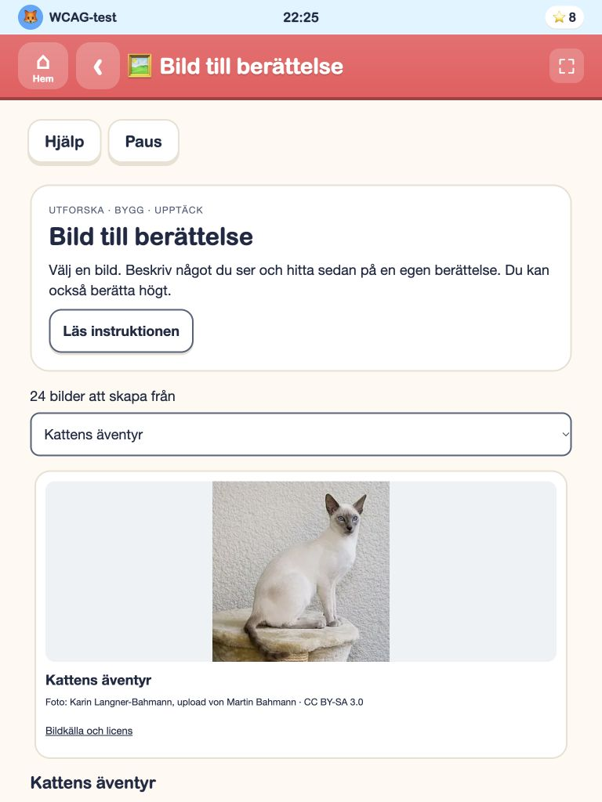
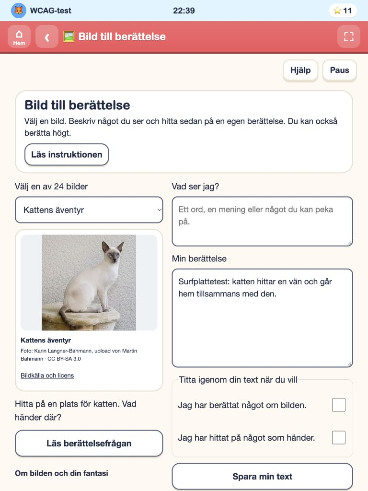
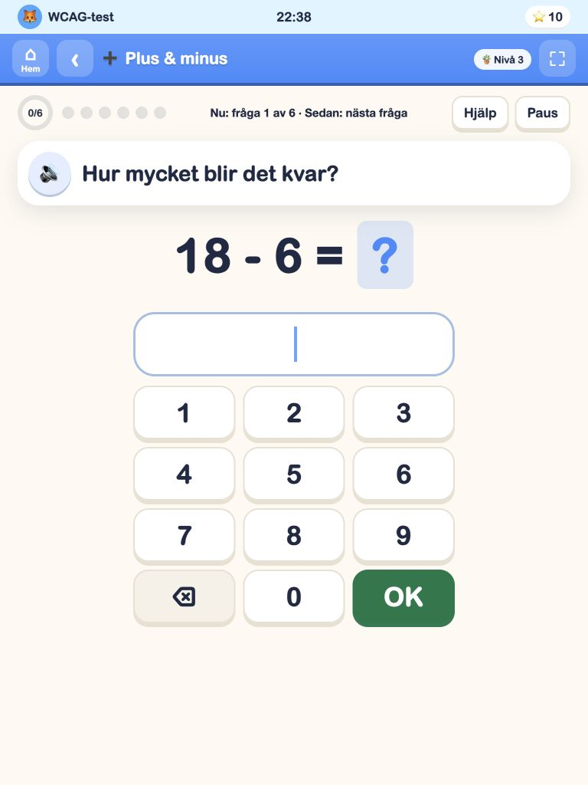
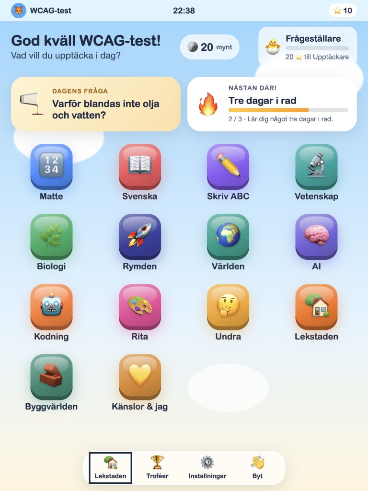

# Surfplatteläget – kvalitetslyft 2026-10-15

Granskningen utgick från den publicerade appen i ansluten Chrome och aktuella skärmbilder. Tre agenter arbetade med skal/navigation, aktivitetsflöden och läs-/skrivytor. De granskade sedan varandras kod och faktiska slutbilder. Befintligt formspråk, profiler, kursinnehåll och sparnycklar behölls.

## Genomgång steg för steg

| Steg | Flöde | Före | Åtgärd och slutbedömning |
| --- | --- | --- | --- |
| 1 | Hem och navigation | Stor rubrik, docka över den synliga appraden, uppbyggnad av ikoner med fördröjning | Kompaktare rubrik, separat reserverat dockutrymme och omedelbart läsbara ikoner. Alla 14 appar syns ovanför dockan i slutbilden vid 768 px. Godkänd i granskade format. |
| 2 | Appmenyer | Låsta fördjupningar låg först; långa menyer visades ett kort i taget | Tillgängliga aktiviteter kommer först i stabil ordning. Låsta kort har tydlig nivå och aria-disabled; inget felsvarsljud/skak vid nyfiket tryck. Fördröjda entréer borttagna. Alla 14 startvyer bildgranskade vid 1024 px. |
| 3 | Quiz | Svar låg långt från frågan i stående läge; nästa fråga kunde behålla föregående scroll | Mindre verktygsrad, närmare svar och återställd aktivitetsscroll/fokus vid Nästa. Två riktiga matteövergångar verifierade, inklusive 568×320 där aktiviteten måste scrollas. Godkänd. |
| 4 | Bild till berättelse | Hela första skärmen gick till instruktion och foto; textfält kom långt ned | Bild/uppgift och skrivfält ligger bredvid varandra på surfplattor med plats. Små skärmar använder en kolumn. Instruktioner och uppläsning finns kvar. Sparning, bildbyte och omladdning bevarade testtexten. Godkänd. |
| 5 | Faktaläsaren | Texten och svaren blev en lång stapel | Texten finns bredvid frågorna på bred skärm. Läsposition bevaras vid val/kontroll/ledtråd, regressionstestat. Riktigt svar om biblioteket kontrollerat i Chrome. Godkänd. |
| 6 | Frågekort och dialog | Vänsterställd stor yta, överdimensionerad stöd-/dekorationsyta | Centrerat kort och tätare innehåll. Svaret gick att vända fram; användarbytesdialog låg i native top layer ovanför svaret. Godkänd i granskade bilder. |
| 7 | Skärmanpassning och bakgrundskontroller | Dolda dockkontroller kunde nås när en app var öppen; statusomritning tappade profilknappens fokus | Dockan är inert medan appen är öppen och återställs på Hem. Profilknappens fokus bevaras vid statusuppdatering. Långa titlar kan radbrytas, programmatisk rubrikfokus ger ingen dekorationsram. Regressionstester passerar. |

## Skärmbilder

Bilderna finns i `audit-tablet-quality-2026-10-15/`. Före/efter jämfördes vid samma fönsterstorlek. För tidigt fångade menybilder med pågående övergång förkastades och togs om.

### Bildberättelse före och efter, 768 × 1024

### Quiz efter, 768 × 1024

### Hem efter, 768 × 1024

## Verifiering

- 514/514 automatiska tester passerade efter sista funktionsändringen. Fyra nya regressioner och förstärkta befintliga tester täcker navigation, fokus, modulordning, quizscroll och läsposition.
- Produktionsbygget passerade efter den sista CSS-kompatibilitetsjusteringen. Samtidig ändring för äldre iPads color-mix-stöd sammanfogades; genererade HTML-filer byggdes om från båda ändringarna.
- Det nya CSS-verktygets låsta beroende uppdaterades inom befintligt versionsintervall. Npm rapporterade därefter noll kända sårbarheter.
- Alla 14 startvyer hade scrollbredd lika med tillgänglig bredd vid både 320 och 1024 px; ingen sidöverfyllnad i dessa kontroller. Det är 28 öppnade startvyer, inte en genomspelning av alla deras aktiviteter.
- Ytterligare flöden mättes vid 390×844, 568×320, 768×1024, 820×1180 och 1366×1024. Läs-/skrivfält och rubriker granskades i liggande och stående läge. Vid 320 px återgår bildberättelsen till en kolumn utan sidöverflöde.
- Verkliga flöden: Hem→ämne→aktivitet→Tillbaka/Hem, svar→Nästa, skriv→spara→bildbyte→återkomst→omladdning, faktasvar→kontroll och frågekort→svar→användarbytesdialog→Stanna.
- Ingen varning eller felpost i den fångade webbläsarloggen. Tillfällig fönsterstorlek återställdes och testprofilens Tablet-läge behölls.

## Gränser för bedömningen

Detta är ett konkret kvalitetslyft, inte en garanti om att hela appen saknar fel eller är kommersiellt certifierad. Fysisk iPad/Safari, touchpenna, skärmläsare och skärmtangentbord har inte provats i detta varv. Äldre Safari har kodmässiga reservregler; dess faktiska rendering är inte verifierad på en fysisk äldre iPad. Automatisk CLI-webbläsarkörning användes inte; verkliga flöden provades via ansluten Chrome.

Nästa kvalitetsspärr inför en kommersiell lansering är provning på faktiska målplattor och med barn i målgrupperna, särskilt skrivande med tangentbord/penna, begriplighet och återkomst efter avbruten session. Första nedladdningens prestanda bör mätas separat: appen innehåller fortfarande ett stort inbäddat bildbibliotek för sin fristående distribution.
